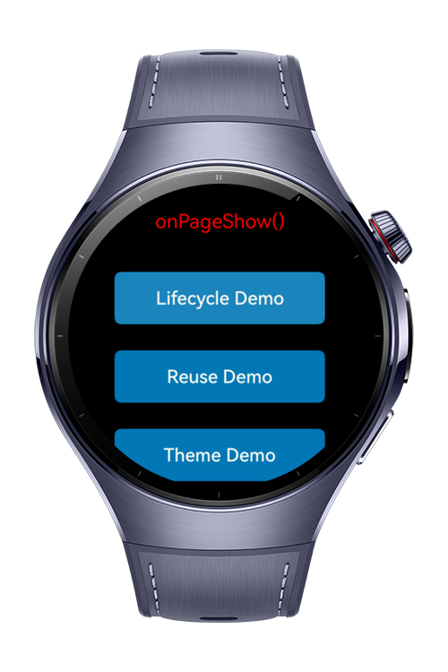
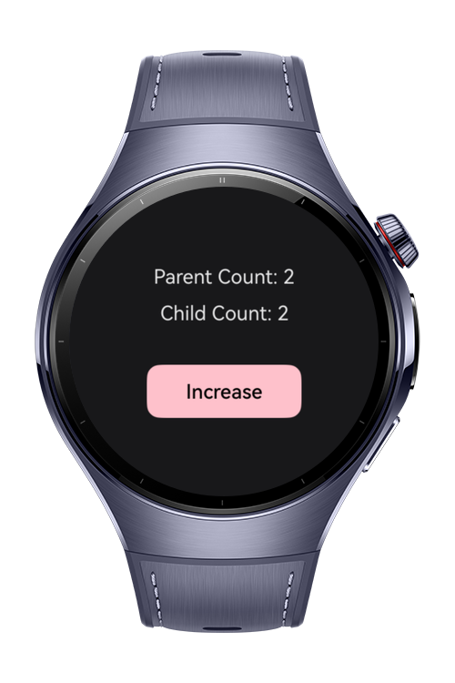

> **Note:** To access all shared projects, get information about environment setup, and view other guides, please visit [Explore-In-HMOS-Wearable Index](https://github.com/Explore-In-HMOS-Wearable/hmos-index).

# How to Build Component Lifecycle Toolkit

The `how_to_build_component_lifecycle_toolkit` codelab demonstrates how component lifecycle works on smart wearables.

# Preview

<div>
  
  
</div>

# Use Cases

- **Index.ets**: Demonstrates page lifecycle events such as **onPageShow()**, **onPageHide()**, and **onBackPress()**.
- **Lifecycle Demo**: Demonstrates component lifecycle callbacks including **aboutToAppear()**, **onDidBuild()**, and **aboutToDisappear()**.
- **Reuse Demo**: Demonstrates reusable component lifecycle callbacks **aboutToReuse()** and **aboutToRecycle()**.
- **@Link Demo**: Demonstrates two-way data synchronization using **@Link**.

The codelab also showcases state management and dependency sharing using **@State**, **@Prop**, **@Provide**, and **@Consume**.
# Tech Stack

- **Languages**: ArkTS / ArkUI
- **Frameworks**: HarmonyOS SDK 6.0.1(21)
- **Tools**: DevEco Studio(6.1.1)
- **Libraries**:
  - `@kit.ArkUI`

# Directory Structure

```
entry/src/main/
|---ets/
|   |---components/
|   |   |---ChildComponent.ets 
|   |   |---NavigationButton.ets 
|   |---entryability/
|   |   |---EntryAbility.ets          
|   |---entrybackupability/
|   |   |---EntryBackupAbility.ets
|   |---pages/
|       |---Index.ets
|       |---LifecycleDemo.ets       
|       |---LinkDemo.ets        
|       |---ReuseDemo.ets  
|       |---ThemeDemo.ets
|---resources/
|   |---base/
|   |   |---element/
|   |   |   |---color.json            
|   |   |   |---float.json
|   |   |   |---string.json          
|   |   |---media/
|   |   |---profile/
|   |---dark/
|       |---element/
|           |---color.json            
|---module.json5                     
```

# Constraints and Restrictions

## Supported Devices

- Huawei Watch 5

# License

How to Build Component Lifecycle Toolkit is distributed under the terms of the MIT License.
See the [LICENSE](LICENSE) for more information.
